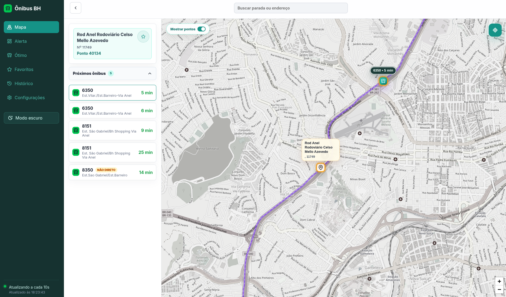

<p align="center">
  
</p>

<h1 align="center">Ônibus BH</h1>

<p align="center">
  Encontre paradas, acompanhe ônibus e consulte a rede Ótimo/RMBH.
</p>

## Funcionalidades

- Localizar e buscar paradas por endereço ou código.
- Consultar previsões e acompanhar veículos municipais no mapa.
- Explorar linhas, pontos e horários planejados da rede Ótimo/RMBH.
- Salvar paradas e configurar alertas locais de aproximação.
- Usar o app em telas pequenas e alternar entre temas claro e escuro.

## Fontes de dados

| Rede | Dados disponíveis |
| --- | --- |
| SIU Mobile BH | Paradas, previsões, itinerários e veículos em tempo real |
| Mobilibus · Ótimo/RMBH | Linhas, pontos, partidas e horários planejados |

Horários planejados não são previsões de chegada nem indicam a posição atual dos veículos. O navegador acessa as integrações por meio das rotas internas `/api/*`.

## Desenvolvimento local

Requer Node.js `24.x` e npm. Com `nvm`, selecione a versão indicada em [`.nvmrc`](.nvmrc):

```sh
nvm install
nvm use
npm install
npm run dev
```

O Vite inicia o app em `http://localhost:5173` e encaminha `/api/*` pelo middleware local.

Os mapas usam OpenStreetMap por padrão. Para usar os estilos CARTO, copie `.env.example` para `.env.local`, preencha `VITE_CARTO_API_KEY` com uma chave pública restrita aos domínios autorizados e reinicie o Vite.

O Vite inclui no bundle do navegador os valores `VITE_*` usados pelo frontend. Use esse prefixo apenas para dados públicos; mantenha credenciais privadas nas funções server-side da Vercel.

### Comandos úteis

```sh
npm run lint
npm run test
npm run build
```

## Deploy

A aplicação é implantada na Vercel. Use `npm run build` como comando de build e `dist` como diretório de saída. O runtime é Node.js `24.x`.

## Documentação

- [Arquitetura](ARCHITECTURE.md)
- [Design e UX](DESIGN.md)
- [Decisões do projeto](docs/decisions.md)
- [Pesquisa sobre Mobilibus, Ótimo e SIU](docs/mobilibus-otimo-api-research.md)

## Licença

[MIT](LICENSE).
